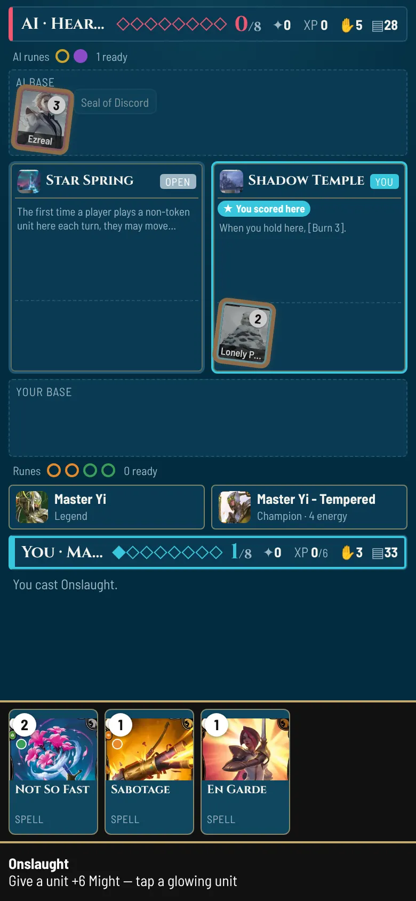
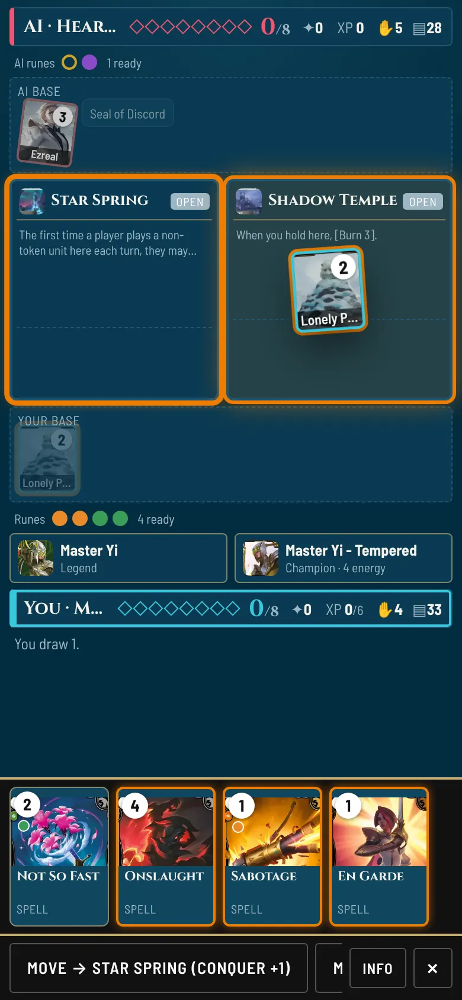
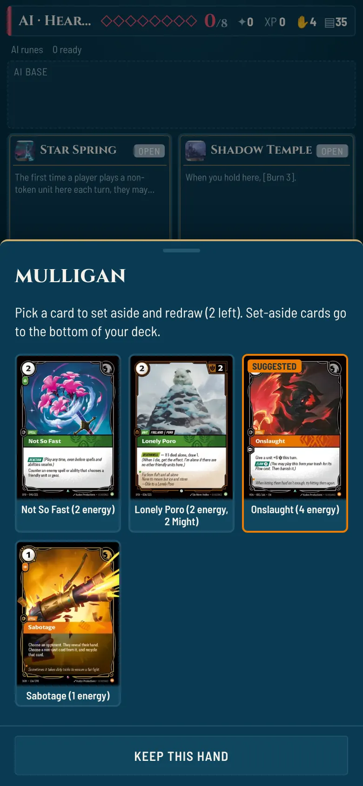
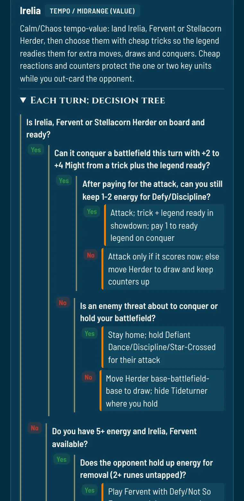

<div align="center">

# ⚔️ Rift Table

**Play Riftbound, the League of Legends trading card game, against an AI on your phone, and measure how well a simulator prices the real tournament metagame.**

[**▶ Play in your browser**](https://napi2002.github.io/riftbound-sim-naps/play.html) · [**📊 Research report**](https://napi2002.github.io/riftbound-sim-naps/report.html) · [**🌐 Project site**](https://napi2002.github.io/riftbound-sim-naps/)


   

</div>

---

## Contents

- [What it is](#what-it-is)
- [The game](#-the-game)
- [The research](#-the-research)
- [Quick start](#-quick-start)
- [Repository layout](#-repository-layout)
- [How it works](#-how-it-works)
- [Testing](#-testing)
- [Data sources and credits](#-data-sources-and-credits)

## What it is

Rift Table is two things built on one rules engine:

1. **A mobile game.** A single self-contained HTML file (`riftable.html`, ~6 MB with card art) that plays a full game of Riftbound against an AI. No install, no server, and it works offline once loaded.
2. **A quantitative study.** A seeded Monte Carlo harness plays the 15 decks against each other hundreds of thousands of times and compares the results with 45,836 real tournament matches. The aim is to find out whether a game engine can rank decks the way the real metagame does.

## 🎮 The game

| | |
|---|---|
| **Full rules** | Showdowns, Hidden, Ambush, Accelerate, Equip, Deploy, Legion, Level, Empower, Deathknell, burn-out and the final-point rule. Audited against the official Core Rules (October 2026), with regression tests. |
| **Every card in the game** | All 1,099 cards (every set through Radiance) are built in. Rules text is parsed into effects, and complex cards and legends have hand-written scripts. Optional effects ask before resolving. |
| **15 suggested tournament decks** | Lists from real events (LA Regional, Singapore RQ, Sacramento Showdown and others). Each shows its real tournament win rate. |
| **Build or import your own** | A deck builder for any legend: pick a champion, search and filter the full card pool, set runes and battlefields, and get a live Core Rules legality check. You can also paste a text decklist to import it, or copy yours out. Decks are saved in your browser. |
| **An AI with a plan** | Each deck follows a researched pro game plan: mulligan, card priorities, attack style and which reactions to hold. It only plays a trick when it flips the fight. |
| **Built for phones** | Drag units onto battlefields, card choices show the actual cards, and there's a combat report, points tracker, keyword badges, light and dark themes, and a Riftbound-inspired look. |
| **Learn as you play** | Per-deck decision trees ("how pros play"), the matchup note for your opponent, and a post-game review built from what actually happened. |

**Suggested decks:** Kennen · LeBlanc · Rengar · Irelia · Akali · Jayce · Master Yi · Azir · Vex · Rek'Sai · Riven · Evelynn · Mordekaiser · Orianna · Seraphine

### Building and importing decks

Tap **+ Build a deck** or **Import text** on the menu. The builder checks the deck against Core Rules 103 as you go:
- **Legend:** decides your domains; every card must fit them.
- **Chosen Champion:** must share the legend's champion tag.
- **Main deck:** at least 40 cards with the champion included, at most 3 copies of a card, and at most 3 Signature cards of your champion.
- **Runes:** exactly 12, in your domains.
- **Battlefields:** 3, all with different names.

Cards banned in tournament play are flagged but still allowed against the AI.

The parser fully simulates all 15 suggested decks. In other cards some abilities aren't simulated yet; the builder marks those cards with ⚠ and shows how many your deck contains.

Import accepts the common decklist format. Headers are optional, and lines can be `3 Card Name`, `3x Card Name` or `Card Name x3`:

```text
Legend:
1 Irelia - Blade Dancer
Champion:
1 Irelia, Fervent
Main Deck:
3 Stellacorn Herder
3 Defy
...
Battlefields:
1 Abandoned Hall
1 Sunken Temple
1 Targon's Peak
Runes:
6 Calm Rune
6 Chaos Rune
```

## 📊 The research

The project treats the metagame like a market: decks are assets, matchups form a payoff matrix, deck popularity behaves like portfolio weights, and the simulator is a pricing model that has to be validated out of sample.

**Five pre-registered hypotheses** ([`quant/PREREGISTRATION.md`](quant/PREREGISTRATION.md)):

| | Hypothesis | Test |
|---|---|---|
| H1 | A frozen simulator ranks decks like real win rates on unseen data | Spearman ρ, permutation p, bootstrap CI |
| H2 | Simulated matchups beat a one-strength-per-deck (Bradley–Terry) baseline | Log-loss / Brier, paired bootstrap |
| H3 | Decks that beat the field gain play share next week (replicator dynamics) | Panel regression, walk-forward vs random walk |
| H4 | The metagame is exploitable, and less so as a set ages | Nash equilibrium (LP), Mann–Kendall trend |
| H5 | Simulated card value agrees with what pros actually play | Card ablation vs inclusion rate |

**Results so far (in-sample: the AI was tuned while it was being measured):**

| | All 15 decks | 10 established decks |
|---|---|---|
| Spearman ρ, simulated vs real win rate | **0.52** (p = 0.047) | **0.57** (p = 0.093) |

<details>
<summary>Per-deck results: 210,000 simulated games vs 45,836 real matches</summary>

| Deck | Real win rate | Real matches | Simulated | Sim − real |
|---|---|---|---|---|
| Riven | 62% | 709 | 57.2% | −5 |
| Kennen | 58% | 6,289 | 66.6% | +9 |
| Irelia | 56% | 7,224 | 39.2% | −17 |
| Rengar | 55% | 5,600 | 65.0% | +10 |
| LeBlanc | 53% | 6,216 | 80.7% | +28 |
| Master Yi | 53% | 4,571 | 68.9% | +16 |
| Vex | 53% | 4,011 | 55.6% | +3 |
| Jayce | 52% | 4,984 | 48.5% | −3 |
| Rek'Sai | 52% | 3,239 | 45.6% | −6 |
| Azir | 51% | 3,831 | 25.6% | −25 |
| Akali | 48% | 4,108 | 30.5% | −18 |
| Evelynn | 45% | 219 | 64.1% | +19 |
| Mordekaiser | 45% | 185 | 60.3% | +15 |
| Orianna | 42% | 170 | 27.7% | −14 |
| Seraphine | 36% | 143 | 14.5% | −22 |

Simulated win rates use 95% Wilson intervals of about ±0.6 points. The first player wins 56.6% of simulated games.
</details>

**Main finding so far: a piloting gap.** Simulated win rates spread far wider than real ones, so part of each simulated number measures how well the AI pilots a deck, not just how strong the deck is. Simple proactive plans are overrated, while decks that depend on combat timing or slow engines are underrated. The confirmatory tests run on tournament data collected after the engine is frozen.

➡️ The full write-up, with charts, is in the [research report](https://napi2002.github.io/riftbound-sim-naps/report.html) ([source](docs/report.html)).

## 🚀 Quick start

You only need **Node.js 18+** and **Python 3.10+**. The project has no npm or pip dependencies.

```sh
# play: open the prebuilt file in any browser (best on a phone)
open riftable.html

# rebuild the game and the public site after changing src/
python3 tools/build.py          # -> riftable.html
python3 tools/build_site.py     # -> docs/ (landing page, report, play.html)

# run the research harness
node quant/harness.js --pairs-per-matchup 1000   # 210,000 seeded games, ~2.5 min on 4 cores
python3 quant/snapshot.py                        # archive today's tournament meta snapshot
python3 quant/tidy.py                            # snapshots -> tidy CSVs
```

## 🗂 Repository layout

```text
.
├── riftable.html            # the built game: one self-contained file
├── src/
│   ├── engine.js            # rules engine, rules-text parser, card/legend scripts, decks, AI
│   ├── ui.js                # mobile UI: board, drag and drop, prompts, guides, reviews
│   ├── style.css            # Riftbound-inspired theme (light and dark)
│   ├── template.html        # page shell and in-game rules summary
│   ├── cards.json           # all 1,099 cards (Riftcodex + riftbound.gg, incl. Radiance; banned flags)
│   ├── guides.json          # researched pro game plans and decision trees for 15 decks
│   └── img/                 # card art for the built-in decks (WebP)
├── quant/
│   ├── harness.js           # seeded, mirrored round robin across worker processes
│   ├── snapshot.py          # archives the meta snapshot (raw JSON + SHA-256 manifest)
│   ├── tidy.py              # deck / matchup / card tables from the snapshots
│   ├── PREREGISTRATION.md   # hypotheses, tests, thresholds, holdout rule
│   └── data/                # raw snapshots, manifest, simulation summaries
├── test/
│   ├── sim.js               # headless AI-vs-AI games + card coverage per deck
│   ├── rules.js             # Core Rules regression checks
│   ├── battlefields.js      # every battlefield's effect
│   └── bench.js             # AI vs random / rush / itself
├── tools/
│   ├── build.py             # assembles riftable.html
│   ├── build_site.py        # builds docs/ for GitHub Pages
│   ├── fetch_cards.py, fetch_dotgg.py, build_data.py   # card data pipeline
│   ├── fetch_images.py      # card art -> WebP
│   └── merge_guides.py      # merges and validates researched deck guides
├── docs/                    # public site: index.html, report.html, play.html
└── .github/workflows/snapshot.yml   # weekly meta snapshot
```

## 🔧 How it works

<details>
<summary><b>Rules engine</b></summary>

`src/engine.js` models the full turn: awaken, score holds, channel runes, draw, main phase, end of turn. Runes pay energy (exhaust) or power (recycle), and the engine pays costs automatically. Combat runs a showdown in which both players alternate Reactions, Actions, Ambush units, face-down cards and legend abilities, starting with the player who moved in. Then it assigns damage in Tank → normal → Backline order. Moving onto an empty battlefield opens a non-combat showdown before the conquer. Human decisions go through one async `ask()` interface (confirm, target or choice); the AI answers the same requests automatically.
</details>

<details>
<summary><b>Card parser and scripts</b></summary>

Each card's rules text is split into lines and parsed into effect operations (`deal`, `draw`, `stun`, `moveUnit`, `buff`, `token`…) with targets. Cards and legends whose text the generic parser can't express have hand-written scripts. `node test/sim.js` reports how much of each deck's rules text is simulated: 100% for every deck except one card line.
</details>

<details>
<summary><b>AI</b></summary>

The AI is a heuristic player:
- **Card choice:** values each playable card from its effects.
- **Attacks:** plans by comparing total Might (Tank/Backline aware), counting tricks in hand.
- **Showdowns:** plays a trick only if it flips the fight.
- **Opponent's turn:** keeps reactions and energy open.

Each deck layers a researched plan on top (`src/guides.json`): mulligan keep/toss lists, card priorities, reactions to hold, attack style and reserve energy. Every plan change is measured with the harness. Changes that make the simulated ranking worse aren't kept.
</details>

<details>
<summary><b>Simulation harness</b></summary>

`quant/harness.js` plays every pair of decks with a seeded mulberry32 RNG, twice per seed with seats swapped, which cancels the first-player edge. It runs across worker processes, and the same seed gives byte-identical results. It writes one CSV row per game plus a JSON summary with Wilson intervals, the first-player rate and Spearman correlation with the real data.
</details>

<details>
<summary><b>Data pipeline</b></summary>

- **Card data:** Riftcodex and riftbound.gg, merged by `tools/build_data.py`.
- **Tournament statistics:** the riftbound.gg meta snapshot (30-day rolling window). `quant/snapshot.py` saves it unchanged with a SHA-256 manifest, and a GitHub workflow refreshes it weekly.
- **Holdout:** confirmatory tests use only matches played after the engine-freeze tag.
</details>

## ✅ Testing

```sh
node test/sim.js 30          # 30 headless games: crashes, unfinished games, card coverage
node test/rules.js           # stun duration, showdown order, Hidden costs, Equipment recall, Burn Out, Legion
node test/battlefields.js    # every battlefield effect fires
node test/bench.js           # AI vs random (~99%), vs rush (~78%), vs itself (~50%)
node quant/harness.js --check-determinism 20   # same seed -> identical game logs
```

## 🙏 Data sources and credits

- **Card data:** [Riftcodex](https://riftcodex.com) and [riftbound.gg](https://riftbound.gg)
- **Tournament statistics and deck guides:** riftbound.gg (dotgg) meta snapshot, plus tournament reports and deck techs cited in each deck guide
- **Rules:** the official Riftbound Core Rules (2026-10-09)

> Rift Table isn't endorsed by Riot Games and doesn't reflect the views or opinions of Riot Games or anyone officially involved in producing or managing Riot Games properties. Riot Games, Riftbound, League of Legends and all associated properties are trademarks or registered trademarks of Riot Games, Inc. Card images © Riot Games. This is a non-commercial fan project.
